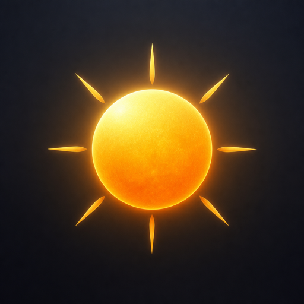
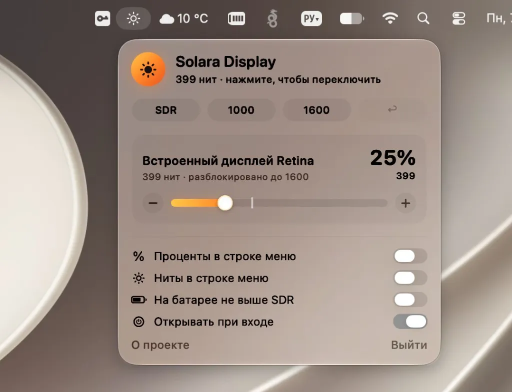

# Solara Display

<p align="center">
  
</p>

Unlocks MacBook Pro brightness up to **1600 nits**. Menu bar, one slider per display.

<p align="center">
  
</p>

**Download:** [Solara Display.dmg](./Solara%20Display.dmg)

**Developed by [www.kompaniec.com](https://www.kompaniec.com)**

## What it does

macOS caps the built-in XDR panel at SDR (~500–600 nits). Solara Display removes that software limit so 100% is the panel’s ~1600 nit peak.

- Per-display sliders
- Keyboard brightness keys follow Solara’s scale, with an on-screen readout
- Presets: SDR, 1000 nits, 1600 nits, restore
- Sync extra monitors to the same percent
- Language switcher: EN / ES / RU / CH
- Optional percent in the menu bar
- Warning at peak (heat / battery)

## Requirements

- **macOS 14 Sonoma** and newer
- **1600 nits:** 14"/16" MacBook Pro 2021+ with Liquid Retina XDR
- External DDC: Apple Silicon

## Install

1. Download **[Solara Display.dmg](./Solara%20Display.dmg)**
2. Drag the app onto **Applications**
3. Launch it from Applications (not from the disk image)

The app lives in the menu bar — no Dock icon. Keep it in `/Applications` if you want **Open at login**.

### Gatekeeper

This build is ad-hoc signed, not notarized. The first open may be blocked.

1. Right-click **Solara Display** → **Open**
2. Or: System Settings → Privacy & Security → Open Anyway

Notarization needs an Apple Developer ID. Sparkle updates are not included.

## Build

```bash
xcodebuild -scheme Solara -configuration Release \
  CONFIGURATION_BUILD_DIR="$PWD/dist"

bash scripts/make-dmg.sh
```

The DMG is written to `dist/Solara Display.dmg`, copied to the repository root, and to `~/Desktop/Solara Display/`.

## License

[MIT](LICENSE) © [www.kompaniec.com](https://www.kompaniec.com)
